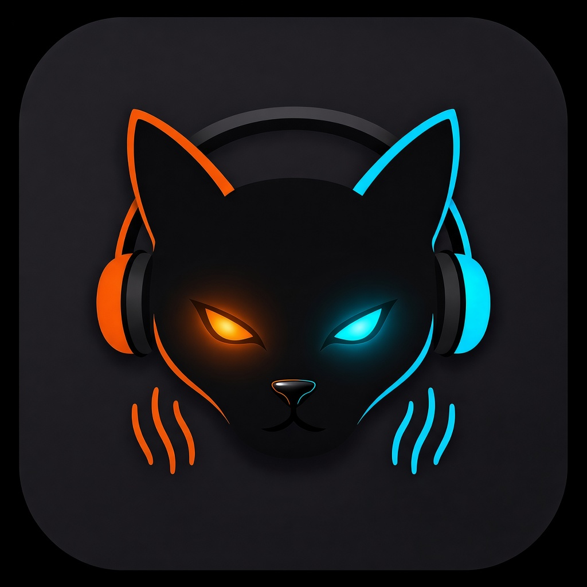

# CONTEXTO — GatoMix



Fuente única. No hay `REGLAS.md` ni otros `.mdc` de ley. No pedir a Gabriel que repita esto.

**Obligatorio en todo chat (también el primero).** Cursor inyecta este archivo + `.cursor/rules/contexto.mdc` (`alwaysApply`) en cada turno. Gabriel **no** tiene que escribir “cero diff”, “no borres” ni pegar este bloque. Si el mensaje no lo dice, el default sigue siendo **Se elimina: NADA**. Silencio ≠ permiso. “Arregla”, “revisa”, “urgente”, “desfasada” **no derogan**. Culpa de un borrado colateral = del agente, no de Gabriel por no repetirlo.

## 00. Todo cambio = todos los dispositivos (ley)

**Todo cambio que Gabriel pida aplica a TODOS los dispositivos:** Windows, Android, macOS **e iPhone** (entrada independiente `lib/djiphone/main.dart` + `PlatformMixStrategy` por plataforma). No se entrega un arreglo/feature "solo Windows" ni "solo celular". Si el código vive en una capa compartida (`lib/providers`, `lib/ui/workspaces`), basta un diff; si hay una estrategia/ruta por plataforma (`lib/core/hal/platform_strategy.dart`, `djiphone/`, rutas de sesión, permisos), se revisa y se alinea en el mismo turno. Si algo no puede ser igual en una plataforma (p. ej. voz/ruido en celular), se dice explícito en el cierre; nunca se deja en silencio.

Verificación mínima al cerrar: nombrar las 4 plataformas y confirmar que el diff las cubre (o cuál queda excluida y por qué). Despliegue = commit + tag `v*` + push (el CI de GitHub arma los ejecutables).

## 0. UI = LOG + OK

Sustituir un hijo (p. ej. rueda LRC por 2 `Text`) = borrar. Compactar, “2 líneas”, “overflow” o “solo celular” no autorizan borrar.

Turno 1: **cero** `StrReplace` / `Write` / `Delete`. Solo el log. Esperar **OK** / “autorizado” / “aplica”.

OK = aplicar el LOG y desplegar en el mismo turno (`clasp push --force` + deploy). Cerrar con @N y que el deploy ya quedó. No pedir otro OK. No esperar un “despliega” aparte.

```
LOG CAMBIO
Pedido: …
Se conserva: lista literal (rueda LRC, Sync I/O, teatro, LAB, SET IN/OUT, cola, PLAY, …)
Se mueve/compacta: …
Se elimina: NADA  |  lo que Gabriel nombró (“quita X”)
Riesgo: 1920px / Mac 13" / móvil
```

Sin ese log + confirmación en un mensaje posterior, no hay diff.

**Cero borrado colateral (UI y motor).** “Se elimina: NADA” vale para **cualquier** diff: widgets, `automixProvider`, `liveDjProvider`, `mix_formula.dart`, DAWN, persistencia, JSON. Arreglar X no autoriza quitar, fusionar, comentar ni “limpiar” ni **una** línea de las que ya funcionaban. “No topar X” no autoriza borrar Y al lado. Alcance = solo el bloque que Gabriel nombró. Si un parche anterior quitó líneas no nombradas: **reponer primero**, luego el arreglo. Turno 1+OK sigue siendo solo UI.

Diff de motor (mismo inventario, sin esperar OK salvo que sea UI):

```
Se conserva: DNA 65/80/75, cue-in 10 s (>30 s, DNA/Phrase), fade 18 s,
             Phrase 8, Stealth 5–10 % / ~60 %, TIPO DE MEZCLA 1→2→3,
             Zero-Start, SET IN/OUT (solo Automix), rueda LRC, persistencia
Se elimina: NADA
```

## 1. Qué es, rol, stack

Reproductor/mezclador DJ (Windows / Android / macOS).

ROL del agente: Staff Software & DSP Engineer Senior. Tono técnico, directo y frío. Cero explicaciones.

**Stack:** Flutter (UI) · Riverpod (State) · media_kit + libmpv (audio C++) · Rust + tokio (FFI/DSP) · Python/yt-dlp (extractor).

Rutas `IndexedStack` (`lib/main.dart`), orden fijo interno:
0 Automix · 1 Masterizar · 2 YT Descarga · 3 Laboratorio · 4 LAN Sync · 5 Live DJ · 6 Karaoke.

Menú ☰ (visual, mismas rutas): Automix · Live DJ · Descargas YT · Laboratorio · Masterizar · LAN Sync · Karaoke.

## 2. Ley marcial

1. **Modificación atómica:** solo el bloque modificado, funciones o clases completas. Prohibido `// ... resto del código`. Lo no tocado se clona byte a byte.
2. **Zero-touch:** prohibido tocar, refactorizar u “optimizar” `automixProvider`, `liveDjProvider` o estilo sin autorización. Cada toque a esos providers, justificado.
3. **Veto técnico:** si el pedido choca con timeouts, I/O locks o bloqueo de hilo, veto. No asfixiar hardware; Tracker, no parches ciegos. Si el gesto/pedido no está 100 % claro, o el agente quiere sustituirlo por una “opción mejor”: **PARA**. Cero `StrReplace` / `Write` / `Delete` de UI/motor. Preguntar a Gabriel. Prohibido inventar el flujo (p. ej. quitar la pausa, segundo clic en 2 en vez del icono de empate, no mostrar la lista de filas). El diseño lo nombra Gabriel; el agente no lo reescribe.
4. **Código:** nivel profesional de plataformas equivalentes. Nada genérico de tutorial.
5. **UI:** estructura de consola DJ, no layout básico.
6. **Cero línea colateral:** el diff solo toca el defecto nombrado. Prohibido borrar ramas `if`, cues, mixes, SET I/O, sesión, widgets o imports “no usados” de paso. Si se perdió, reponer en el mismo turno.
7. **SOLO 2 DECKS. NUNCA un 3er `Player` con una canción (ley de Gabriel, 2026-10-08).** Cada app/modo tiene exactamente 2 reproductores (A y B). Prohibido crear un reproductor extra para medir, analizar, pre-escuchar en el motor, `ao=pcm` o cualquier otro fin: en Android abre una salida OpenSL real y la canción suena encima de la mezcla ("canción fantasma" de ~30 s, comprobado con `dumpsys audio`). Medir/analizar audio se hace en proceso con Rust/symphonia (`decode_mono_pcm`, `exact_duration_ms` en `core_dsp.rs`), jamás con un `Player` ni con FFmpeg externo. Tampoco se exige FFmpeg instalado. Si falta una capacidad, se quita la función; no se vuelve a poner un 3er deck.

## 3. Automix — flujo fijo (Windows = celular)

Tres recuadros abajo + mixer arriba. Siempre.

1. **Explorador** (`LibraryTreePanel`) — carpeta.
2. **Pistas** (`FolderContentPanel`) — Cargar Todo o una pista (+).
3. **Cola** (`AutomixPanel`) — ordenar (A-Z / BPM); PLAY. La canción suena **arriba** en `MixerPanel`.

`MixerPanel` = letra + Sync I/O (GLOBAL / 2-MED) + SET IN / SET OUT + candado + seq/random + play + slider.

Prohibido overlay, crate o pestañas que sustituyan los 3 recuadros. Seq/random solo en MixerPanel.

Bucle infinito. Zero-Start (evasión de silencios). LRC (LRCLib). Lectura de letra a los 10 s salvo la primera pista.

## 4. Módulos

- **Automix** — `automix_workspace.dart` / `automix_provider.dart`. Leer letra y marcar SET IN/OUT. Sin eso no tiene objeto.
- **Live DJ** — `livedj_workspace.dart` / `liveDjProvider`. Fiestas. Cartridge FIFO destructiva. ADN DJ: Remix/EDM ~65 %, Tropical/Salsa/Merengue ~80 %, resto ~75 %. Nadie lee letra ni marca SET I/O. El empate debe ser exacto. Layout vigente (2026-10-04): **Explorador** = columna izquierda a toda la altura, pegada al header (flex 5); a su derecha (flex 19) el player arriba y debajo **carpeta (4) | Cartridge (5)**. Icono de disco: en el celular, en la barra de Live DJ a la derecha del título; en escritorio, a la derecha de NOW PLAYING (`liveDjPlaylistViewProvider`). Al pulsarlo toda la ventana de Live DJ (menú lateral incluido en escritorio) pasa a la pantalla de la canción que está sonando (`currentTrackPath`, no la carpeta del Explorador): carátula y título de esa pista, lista de la carpeta donde está el archivo, y los controles de reproducción (tiempo, barra, línea de mezcla, pausa, siguiente, la que viene, shuffle, BPM, ON AIR y chips). Al cambiar la pista cambia la pantalla. El mismo disco devuelve toda la pantalla de GatoMix. El disco no es un logo. Un BPM fuera de 40–250 no se muestra; si el archivo lo guardó ×100 (14109 = 141.09) se divide (`TrackTags.musicalBpm`). Cada fila del Cartridge muestra el **BPM a la izquierda** de la canción (`livedj_bpm_badge.dart`; orden: `_dj_metadata.json` en la carpeta o padres → etiqueta ID3 `TBPM` → nombre del archivo → "–"). Independiente de Automix: `liveDjDirectoryProvider` (explorador), `liveDjEqualizerProvider` (EQ), controles del SO por motor activo; nada compartido (el BPM del Cartridge no usa `bpmCacheProvider`). Tres motores (TIPO DE MEZCLA cicla 1→2→3; no borrar ninguno): (1) **DNA** 65/80/75 + cue-in Zero-Start 10 s si pista > 30 s + fade 18 s + BPM ±12 %; (2) **Phrase 8** mismo ADN, snap 8 compases, `phraseFadeMs`; (3) **Stealth** entra 5–10 %, cruza ~60 %, cola BPM, `lyricMs` vacío (no lee `.lrc`).
- **Karaoke** — `karaoke_workspace.dart` + `gatomix_tv/`. Laptop = mando (QR, cola, pausa/skip/borrar, INICIAR/FINALIZAR). TV = audio + letra. Laptop **no** abre `media_kit`. Monitor de letra en laptop = reloj visual, sin sonido.
  - `INICIAR KARAOKE` → `EDGE_EXECUTE` (`_K.mp3` + `.lrc` HTTP :55056).
  - `STAGE_STATE` replica cola/QR/votos/pausa. `TV_PAUSE` / `TV_SKIP` / `TV_REMOVE` suben del mando.
  - Fin: scoreboard 8 s y avance; skip corta scoreboard. `FINALIZAR` → `SESSION_END`.
  - Lupa TV: `tv_adb_deployment_service.dart` (ADB + mDNS `_adb-tls-*`, no radar REST :55055). `adb install -r`, launch LEANBACK. Depuración inalámbrica + emparejamiento.
- **Auto-Master / Masterizar** — `dsp_workspace.dart`. Menú: **Masterizar**. Tarjetas (2026-10-08): **MASTERIZACIÓN** (sonido, espacios, BPM, género, cues; NO letras) · **LETRAS** (independiente) · Karaoke IA (Rust + ONNX MDX-Net `UVR-MDX-NET-Inst_HQ_3`, sin Python/FFmpeg, `karaoke_engine.dart` + `karaoke_separate` en `core_dsp.rs`; inferencia con ONNX Runtime `ort` en Windows/macOS y tract en Android/iOS; modelo se descarga la 1.ª vez; vetado en celular) · Auditoría · Reset de Fábrica (solo sonido). No borrar las tarjetas.
  - **Masterizado no destructivo, SIN FFmpeg, igual en Windows/Mac/Android/iPhone:** Rust/symphonia mide sonoridad (BS.1770, ReplayGain), silencio inicial/final y BPM y lo guarda en etiquetas ID3 (`REPLAYGAIN_TRACK_GAIN`, `DJS_*`, `TBPM`). El MP3 NO se recodifica (cero pérdida de generación). Sello "ReGenial Master" solo si la pista quedó analizada. Live DJ lee las etiquetas (`track_tags.dart`): BPM si el nombre no lo trae, silencio final fuera del mix-out, silencio inicial dentro del cue-in.
  - **LETRAS:** solo se acepta un resultado de LRCLib cuando coinciden artista, título y duración (±8 s, duración exacta por Rust). Prohibido recortar el título palabra por palabra o aceptar el primer resultado. Nunca pisa un `.lrc` válido. `_lyrics_auto.json` lista solo las letras automáticas sin tocar; "Borrar letras automáticas" borra solo esas. Las letras de Gabriel jamás se borran.
  - **Reset de Fábrica:** quita sello + etiquetas de sonido y purga ISAR; no toca `.lrc` ni cues manuales.
- **Lab** — `lab_workspace.dart`. Cuarentena `quarantine_registry.json`. Un frame: carpetas flex 2 | pistas 3 | arsenal 5. Default origen = carpeta actual. No dos pantallas.
- **YT** — `yt_workspace.dart`. Menú **Descargas YT** (ruta 2) en Windows **y** celular (☰). No ocultar con `if (isMobile)`. Buscador + extracción en scroll; no recortar la barra de estado. Windows: yt-dlp baja el AAC crudo (m4a, formato `140`; symphonia no decodifica Opus) → `encode_to_mp3` (Rust/LAME, CBR 320) (`yt-dlp.exe` en `%TEMP%` si falta). Android: no `Process.run` de binarios x86; extracción con `YoutubeExplode`. Ya NO se exige FFmpeg en ninguna parte.
- **LAN** — `lan_sync_workspace.dart`. REST `:55055` (`/api/whoami`, radar por lotes de 50 IPs). Flat-Tree en memoria. Radar LAN ≠ lupa TV (ADB).

## 5. Cromo, huecos, zero-touch

| | Windows | Android / iOS |
|---|---|---|
| Nav | sidebar **160 px** `_GatoMixNavColumn` | `_MobileModeBar` **36 px** (`☰ Título ▾`) + overlay 228 px. **No** rail a pantalla completa |
| Stage | resto del Row | `SafeArea` → mode bar → IndexedStack. Padding derecho **48 px** si `viewPadding.right == 0` (gutter Xiaomi) |
| Audio | n/a | Llamada = pausa y reanuda sola (§6c). Minimizar = sigue + `persistSession`. Cerrar = persist + `parkIdleDecks` + stop. Reabrir = misma canción y posición. Android: servicio en primer plano (`audio_service`) con latido por segundo; sin él el SO mata el proceso tras ~10 canciones |

**Paleta (ley):** C Traktor / Native Instruments. Gabriel la cerró 2026-09-21. No volver a Pioneer A ni Serato B. Tokens en `GatoMixTheme` (`lib/providers/theme_provider.dart`). Prohibido hardcodear fondos `#161616` / `#222222`.

| Token | Hex | Uso |
|---|---|---|
| `bgDark` | `#0E1014` | Fondo cabina |
| `bgPanel` | `#1A1E26` | Paneles elevados |
| `deckA` | `#2E9BFF` | Deck A azul Traktor |
| `deckB` / `cyanAccent` | `#F05A22` | Naranja Native Instruments |
| `syncActive` | `#00E676` | Sync / menú idle |
| menú seleccionado | `#43B3AE` | Cardenillo |

**Huecos:** Automix mixer **5** / terna **5** (árbol 2 · pistas 4 · cola 5). Live DJ (todas las plataformas): Explorador 5 | columna derecha 19; en la derecha celular player **5** / fila **6** (2026-10-08, para que quepan los chips de la Radio sin achicar el player), Windows player 5 / fila 5, y la fila = carpeta 4 · cartridge 5. Con el icono de disco activo, la ventana entera es la carpeta; el disco la devuelve al layout de arriba. (Antes: árbol 2 · carpeta 4 · cartridge 5 bajo el player.) Lab: 2 · 3 · 5.

Overflow amarillo = fallo de cálculo. Hijos no-flex (IconButton 48, Slider) no pueden sumar más que el slot: `tightFor` + `shrinkWrap` + FittedBox. **Cero** `BOTTOM OVERFLOWED`. Nunca quitar hijos para que “quepa”.

Altura útil ≈ pantalla − SafeArea − 36 (mode bar) − gutters; el resto en flex.

**Zero-touch** (salvo “quita X” / “borra Y”):

- `LyricsSyncPanel` / letra de `MixerPanel`: título, teatro, LAB, Sync I/O, Sync GLOBAL, Sync 2-MED, **rueda LRC** (`ListWheelScrollView`).
- SET IN / SET OUT / candado / cues / deck painter / slider.
- Explorador, pistas, cola, PLAY, ON AIR, STUDIO 1, SMART ROUTING, cartridge, Cargar Carpeta, QR.
- Sidebar 160 px. Rutas IndexedStack. Menú ☰: Automix · Live DJ · Descargas YT · Laboratorio · Masterizar · LAN Sync · Karaoke (los 7, Windows y celular).
- `automixProvider` / `liveDjProvider`. Sesión minimizar/cerrar/reanudar.
- Live DJ TIPO DE MEZCLA × 3: DNA 65/80/75, cue-in 10 s (>30 s), fade 18 s, Phrase 8, Stealth 5–10 %/~60 %. No sustituir un motor por “return 0”.

Sustituir = borrar: rueda LRC por `Text`/`Column`; sacar la rueda del `Expanded` de `LyricsSyncPanel`; `if (isMobile) no pintar`.

Cómo sí: envolver, reordenar, bajar padding. Mismos hijos. Additive-only.

Pendiente visual (sin tocar estructura): 3 recuadros + letra en landscape Xiaomi sin barra amarilla.

## 6. Riverpod — aislamiento de hilos

Prohibido mezclar listas/UI con el hilo acústico.

| Ámbito | Hilo acústico | Hilo visual |
|---|---|---|
| Automix | `automixProvider` (Audio/FFI/DAWN) | `automixQueueProvider` |
| Live DJ | `liveDjProvider` (Audio/ADN) | cola / cartridge |

Globales: `playedTracksProvider` (session JSON) · `bpmCacheProvider` (Rust `dspWorkerProvider`) · `wasapiRecordProvider` (Master Out: Rust `start_master_recording`/`stop_master_recording`, cpal loopback WASAPI en Windows / entrada en macOS → LAME 320; Android/iOS vetado).

UI no muta estado a pelo: `Notifier` / `Provider`.

## 6b. Colas — estabilidad y fin de cola (2026-10-04)

**Cola estable (Live DJ y Automix):** una canción en cola no se mueve ni desaparece por sí sola.
- Añadir (`+`, Cargar Carpeta, cargar playlist) **solo anexa al final**. Con shuffle activo se mezcla únicamente el lote nuevo; lo ya cargado conserva su orden. Añadir **no** cambia el modo secuencial/shuffle: eso lo decide solo el botón.
- El banco de shuffle (10 órdenes) se aplica **solo** al pulsar el botón de shuffle (y en Automix con la lista vacía). Al reabrir la app **no** se re-mezcla: el orden guardado es la verdad.
- Live DJ: cada una de las 10 secuencias mete cada canción en un solo grupo (no se repite). El grupo llega hasta 20 pistas y la más alta y la más baja no se separan más de 10 BPM. El primer grupo va de menor a mayor; el siguiente baja desde su BPM más alto. Las canciones sin BPM van al final. DNA y Phrase 8 tocan ese orden. Stealth no: sigue eligiendo el BPM más cercano de toda la cola. Automix no usa estos grupos.
- Tocar una fila del Cartridge (play/fila) suena **esa** pista; el resto **no** se reordena (antes se movía al índice 0 y en Stealth sonaba otra).
- Cruce: la pista entrante se quita de la cola **por ruta**, nunca por índice (la cola puede cambiar durante la carga). El deck standby recuerda qué pista precargó (`_standbyArmedPath`); si la cola cambió, se recarga.
- Al restaurar sesión sin pista actual, la primera de la cola pasa a "actual" **y sale de la cola** (no suena dos veces).
- Automix: `syncDynamicPlaylist` ya no re-mezcla todo ni fuerza random al añadir pistas.

**Fin de cola (cola vacía):** se detiene el audio y se **borra la pista residual** (Live DJ: `currentTrackPath`, posición, duración, cue/mix-out; Automix: pista, playlist, índice, letra, solo con `autoMixArmed` y sin siguiente pista; con candado manual se conserva para SET IN/OUT). Se guarda el estado limpio. La siguiente carpeta cargada arranca desde su primera canción, sin reproducir la última de la cola anterior. `copyWith(clearCurrentTrackPath: true)` existe en ambos estados.

## 6c. Foco de audio e interrupciones (2026-10-04)

`lib/services/audio_interruption.dart` (`AudioInterruptionGuard`, paquete `audio_session`), montado en `_MobileAudioLifecycle` (`main.dart`) y `_DjIphoneLifecycle` (`djiphone/main.dart`). Android + iPhone; Windows/macOS no aplica (sin llamadas).
- Al sonar Automix o Live DJ pide el foco (`setActive(true)`); si el SO lo niega, no suena encima.
- Llamada/alarma (interrupción temporal) → pausa ambos decks (también a mitad de cruce) con `pauseForInterruption()`; al terminar reanuda sola con `resumeAfterInterruption()`, solo si la pausa la causó el sistema.
- Otra app toma el audio (pérdida permanente) o se desconectan auriculares/Bluetooth → pausa y **no** reanuda.
- Navegación hablando (duck): la atenúa el SO; no se toca el volumen del motor de mezcla.
- Pausa del usuario → suelta el foco. Cola, posición y sesión no se tocan.

## 6d. Voz — ELIMINADA (2026-10-05)

Gabriel quitó toda la voz: mando de voz (micrófono, "Oye DJ", comandos) y la pregunta "¿Qué pongo?" al abrir. No hay `speech_to_text`, `flutter_tts` ni `volume_controller`; no hay permisos de micrófono/voz en `Info.plist` (iOS/macOS). No reintroducir sin pedido explícito. `AudioInterruptionGuard` (6c) queda sin ventana de voz.

## 7. DSP

**DAWN:** crossfade logarítmico de alta energía. Cruce > 90 % de ganancia real. Prohibido `sin()`/`cos()` en la **ganancia** del crossfade (−3 dB en el medio). Sí trigonometría para otros parámetros (p. ej. `setRate()` al tempo).

```dart
final rateIn = (progress * 1.8).clamp(0.0, 1.0);
final rateOut = ((1.0 - progress) * 1.8).clamp(0.0, 1.0);
final smoothRateIn = pow(rateIn, 1.2).toDouble();
final smoothRateOut = pow(rateOut, 1.2).toDouble();
```

**Duraciones:** Automix auto 7–10 s (`kDawnLeadMs` 5 s antes del SET OUT; cola silencedetect 2–5 s; SET OUT no es corte seco). Manual Automix y Live DJ: 8–18 s, dictada por la **entrante** (compases 4/4 / BPM; sin BPM, 6 % de duración). Live DJ auto: 18 s `activeSync` / 4 s si set > 10 min. Toda mezcla manual = DAWN. Prohibido cortar audio.

**Tempo tras la mezcla (Live DJ, incluido Stealth, y Automix):** la diferencia entre el BPM con el que la entrante empezó a sonar y su BPM real se divide en 5. Al 10 %, 20 %, 30 %, 40 % y 50 % se suma o resta esa quinta parte. A la mitad la canción va en su BPM normal. 10 s antes de la mezcla siguiente se acerca 1-2 BPM al BPM de la que entra. El margen de igualación en el cruce sigue en ±12 %. En mezcla normal una pista no se mezcla consigo misma, y un fin de pista a mitad de cruce no arranca otro cruce. La Radio no se tocó.

**Zero-Lag:** `state.duration` síncrono. Prohibido `timeout()` que bloquee el hilo.

**Hifi:** `af` nativo en libmpv. Prohibido bucles Dart de DSP. No reconstruir `af` por frame. Bass swap: una escritura por deck en el cruce.

**EQ adaptativa + sonoridad igual (2026-10-08):** `AdaptiveEq` mide 30 s de cada canción decodificándola en Rust (`decode_mono_pcm`), sin reproductor ni FFmpeg, en las 4 plataformas. **FFmpeg ERRADICADO de la app (2026-10-08):** MP3 = `encode_to_mp3` (LAME), outro de Automix = `outro_energy_end_ms` (-32 dBFS, racha >= 0.4 s, en Android también), grabación Master Out = cpal+LAME, duración = `exact_duration_ms`. Prohibido volver a invocar `ffmpeg`/`ffprobe` desde Dart. El Karaoke también es Rust (ya no usa `karaoke_ai_processor.py`, que queda sin referenciar). **Motores Rust nativos (2026-10-08):** Karaoke = `ort` (ONNX Runtime, MIT) en Windows/macOS, `tract` (Rust puro) en Android/iOS (vetado en celular), elegido con `cfg` en `karaoke_backend`; no mezclar. **LAME en Android desde host Windows:** `mp3lame-sys` 0.1.11 usa la config MSVC y rompe con el NDK; se parchea con copia local `rust/vendor/mp3lame-sys` (`[patch.crates-io]` en `rust/Cargo.toml`; `configMS.h` usa `<stdint.h>` con clang/gcc, `build.rs` con `pic(true)`). NO borrar `rust/vendor/` ni el `[patch]`. LAME es LGPL: incluir aviso de licencia al distribuir. **Pendiente de probar en celular (Gabriel, 2026-10-09):** compilación/ejecución Android de LAME, cpal vetado, `outro_energy_end_ms`, EQ adaptativa y duración exacta. **Duración real:** `exact_duration_ms` (Rust) corrige la estimada por libmpv en MP3 sin Xing; manda la real si difiere > 1.5 s (barra y punto de mezcla de Live DJ).

## 8. Tokens

1. No releer archivos ya leídos en la sesión.
2. Fuente única: este `CONTEXTO.md` (Apps Drive: `c:\AppScripts\CONTEXTO.md`). Una lectura, no re-derivar.
3. `Grep`/`Read` con offset/limit.
4. Respuestas concisas; un diff, no pegar el archivo.
5. No listar árboles de nuevo.
6. Terminal: salida a archivo; no volcar el wrapper PowerShell.
7. Glob/Grep en paralelo.
8. Apps Drive → `c:\AppScripts`, no este repo.
9. `.cursorignore` ya excluye tooling, `build/`, `.dart_tool/`, `venv/`, `__pycache__/`. No indexar esos paths.

## 9. Permisos Android (APK)

`READ_MEDIA_AUDIO` (API 33+) · `READ_EXTERNAL_STORAGE` (maxSdkVersion 32) · `WRITE_EXTERNAL_STORAGE`. Sin `MANAGE_EXTERNAL_STORAGE`: Google Play lo rechaza. La biblioteca sale de MediaStore (incluye SD), no de una carpeta llamada Music. Sin micrófono: `RECORD_AUDIO` y los `<queries>` de voz (reconocedor/TTS) se quitaron el 2026-10-05.

## 10. CI GitHub (Windows · Android · macOS)

**Regla de Gabriel (2026-10-05): NO hacer `git push` (ni subir tags) a GitHub hasta que él lo diga directamente.** Esto anula el "OK = desplegar" de la sección 0: tras un OK se aplican los cambios y se puede hacer commit local, pero el push solo cuando Gabriel escriba la orden. Un tag pusheado dispara el CI.

**"Sube al Git" / "haz push" = SIEMPRE generar versión (regla de Gabriel, 2026-10-05).** Cada vez que Gabriel diga "sube al Git", "haz push" o equivalente, el agente hace TODO en el mismo turno: commit + subir versión (siguiente versión del esquema nuevo `v3.0.N`: numeración nueva 2026-10-09, arranca en `v3.0.1`, luego `v3.0.2`, `v3.0.3`… sin saltos (los tags `v1.0.0–v1.0.100` y `v2.0.x` ya existen en GitHub y NO se reutilizan ni se borran; son historia); El tag fija la versión: el workflow la pasa a `--build-name`, al instalador Windows y al APK; mantener `pubspec.yaml` en la misma `1.0.N`; anotarla en "Versión actual desplegada") + tag `v*` + `git push origin main` + `git push origin v*`. Un push sin tag no genera instaladores y no cuenta. No preguntar si quiere tag.

Workflow: `.github/workflows/release.yml`. Tag `v*` dispara build en las 3:

| Target | Runner | Salida |
|---|---|---|
| Android | ubuntu | `app-release.apk` |
| Windows | windows | `GatoMix-Installer.exe` (`windows_setup.iss` / Inno Setup) |
| macOS | macos | `GatoMix-MacOS.zip` |

Sonido (todas las plataformas, `platform_strategy.dart` + `audio_equalizer_service.dart`): VERIFICADO (sondeo real del `libmpv-2.dll` de Windows, mpv 0.36 build "audio"): de libavfilter solo existe `equalizer`; NO existen `loudnorm`, `dynaudnorm`, `alimiter`, `volume`, `bass`, `highpass`. Una cadena `af` con UN solo filtro desconocido se rechaza ENTERA (error -9) y `setProperty` lo traga: así nunca funcionaron el nivelador/limitador/EQ/bass-swap anteriores. Por eso `lib/core/audio/af_caps.dart` (`AfCaps.probe()` + `AfCaps.sanitize(cadena)`) sondea al arrancar qué filtros acepta el libmpv de CADA plataforma y quita los que no. Toda cadena `af` pasa por `sanitize`. Cadena = color de plataforma (vacío) -> `equalizer` x10 (EQ usuario + canción + sonoridad) -> limitador solo si el libmpv trae `alimiter`. Sin filtro `volume`, el margen (headroom) y la sonoridad se logran DESPLAZANDO las bandas del `equalizer`, y `AdaptiveEq._solveCascade` resuelve las ganancias para que la respuesta real de la cascada (bandas solapadas) sea la pedida. `replaygain-fallback` solo se lee al cargar el archivo (medido): NO sirve para nivelar en vivo. EQ adaptativa y sonoridad por canción (`lib/services/adaptive_eq.dart`, compartida por Automix, Live DJ y FiestaDJ): mide 30 s del tema (libmpv `ao=pcm`, verificado en Windows; FFmpeg como respaldo en escritorio si existe) con FFT en 10 bandas octava (corrección máx ±3 dB, sin realzar lo que el archivo no tiene) y sonoridad K-weighted con compuertas hacia -16 LUFS (ganancia limitada por el pico). Bass kill del cruce (Automix/Live DJ) = dos `equalizer` (45 y 110 Hz), no `highpass`. FFmpeg NO se empaqueta (Rust DSP, grabación WASAPI y descargas lo buscan junto al exe o en PATH). Caché `_adaptive_audio.json`. Cada deck lleva la curva de SU canción (`filterFor(player)`); se registra con `adapt(player, path)` tras cada `open()`. Interruptor global `AdaptiveEq.enabled`.

Firma Android: el APK de CI se firma con llave fija (secretos de GitHub `ANDROID_KEYSTORE_BASE64`, `ANDROID_KEYSTORE_PASSWORD`, `ANDROID_KEY_ALIAS`, `ANDROID_KEY_PASSWORD`; copia local en `%USERPROFILE%\gatomix-keys`, NUNCA al repo) y `versionCode = 100 + run_number`, para actualizar encima sin desinstalar. Sin secretos cae a firma debug.

Controles externos (notificación / bloqueo): `DjAudioHandler` tiene un dueño (`claim` al sonar; `syncOs` solo escribe el dueño o quien suena). Título/duración se refrescan siempre con la pista real. `pause` real desde la notificación (se ignora ≤2 s tras minimizar: `noteAppBackgrounded`); `play` no pausa si ya suena. Automix siguiente/anterior dan la vuelta; Live DJ anterior reinicia la canción.

FiestaDJ — ELIMINADA (2026-10-05). Gabriel quitó el módulo completo (ruta 7, `lib/fiestadj/`, provider, workspace, entradas de menú/sidebar, foco de audio). Rutas vigentes: 0–6. No reintroducir sin pedido explícito. Los 3 tipos de mezcla y el cue-in 10 s de Live DJ no se tocaron.

Versión actual desplegada: `v1.0.0` (v1.0.0: el producto se llama GatoMix, versión reiniciada por orden de Gabriel el 2026-10-22; el detalle del cambio de nombre está en CHANGELOG.md. Historial previo v3.0.20: relevo Live DJ v2, la canción que entra empuja a la que sale con giro, derrame de color y remate; v3.0.19: en la vista del disco el subtítulo es el título de la canción, la carátula crece, la cola es solo vista y la canción que entra empuja a la que sale con fundido de color; v3.0.18: la pantalla grande sigue la canción que suena, con barra, pausa y la que viene; v3.0.17: en el celular el disco de la vista de carpeta está en la barra de Live DJ, a la derecha del título; v3.0.16: icono de disco en NOW PLAYING abre la carpeta a pantalla completa y el mismo disco devuelve Live DJ; un BPM de miles (14109) se lee como 141.09; v3.0.15: mezcla normal no cruza una pista consigo misma y, si el audio acaba antes que la barra, mezcla 25 s antes; Shuffle agrupa sin repetir canción y a lo más 10 BPM dentro del grupo; v3.0.14: Shuffle de Live DJ en grupos de 20 por BPM — el primero sube, el siguiente baja desde su BPM más alto, 10 secuencias; tras la mezcla la diferencia de BPM se divide en 5 y se aplica al 10/20/30/40/50 % hasta el BPM real, incluido Stealth; v3.0.13: tempo sutil cada 10 % (`tempo_drift.dart`: 2 BPM al 10 %, 1 BPM 20-40 %, 0.5 BPM 50-90 %, empujón al BPM del siguiente 10 s antes de la mezcla); pista Mix (>10 min) se mezcla 30 s antes del final; red de seguridad: mezcla a ≤25 s del final si no se disparó; al terminar sin mezcla suena la pista precargada; bitácora `gatomix_livedj_trace.txt` en la carpeta temporal; v3.0.12: descarga robusta de yt-dlp.exe (`lib/core/net/safe_download.dart`: Dart → curl.exe → PowerShell, certificados de Windows, nunca desactiva la verificación); Karaoke TV: adb desde SDK/PATH o descarga platform-tools a `%LOCALAPPDATA%\GatoMix`, conexión manual real (IP sin puerto = 5555), APK de la TV bajado del release (`gatomix-tv.apk`, job `gatomix_tv` del workflow, `continue-on-error`) cuando no hay carpeta `gatomix_tv`; Radio nunca se para: sin carpetas de género usa toda Música como "Todo", relaja exclusión del Explorador, último recurso la cola; chips de género apagados sin carpeta (`radioGenresAvailable`); info de artista (foto Deezer + bio Wikipedia, caché en disco, `artist_info.dart` / `livedj_artist_card.dart`) a la derecha del título; v3.0.11: Live DJ — flecha ROJA de pre-escucha por canción de la cola, solo Windows y solo con audífono detectado (`lib/core/audio/cue_preview.dart`: reproductor aparte, NO es deck, salida fijada al audífono; si no queda fijado no suena; el Play verde la detiene); buscador de cola en la barra de TIPO DE MEZCLA (`liveDjQueueSearchProvider`, solo filtra la vista); chip BPM a la derecha del título en NOW PLAYING; DESCARGAS YT en Android/iOS baja y previsualiza con `youtube_explode_dart` (sin yt-dlp → arregla "ProcessPermission denied"); Windows/macOS siguen con yt-dlp; v3.0.10: tempo sutil en Live DJ y Automix — `lib/core/audio/tempo_drift.dart`: antes de la mezcla el saliente se acerca 1-2 BPM al BPM del siguiente; si el entrante se corrigió ≥3 % NO vuelve de golpe a 1.0: conserva el tempo igualado y se acerca 1-2 BPM a su BPM real al 50 % y al 75 % (rampas lentas); correcciones pequeñas conservan el glide de siempre; v3.0.9: LiveDJ entra en el golpe — nueva `beat_grid` en Rust (`core_dsp.rs`, bindings regenerados) mide BPM y fase de ambas pistas y `_triggerCrossfade` arranca el entrante en su golpe cuando suena el siguiente golpe del saliente; si la pista no trae BPM usa el medido; filtros `af` y corrección de tono del deck entrante se fijan ANTES de `play()` (`_prepareIncomingDeck`) para evitar los 2-3 s de tempo inestable; v3.0.8: LiveDJ dibuja en la barra una línea roja en `customMixOutMs` (punto de mezcla de DNA / Phrase 8 / Stealth) en `livedj_workspace.dart`; menos CPU: `_calculateRadioMixOut` memorizado por pista/fórmula y el estado de posición de LiveDJ/Automix se publica cada 250 ms en vez de 120 ms (el disparo de mezcla sigue usando el tick real); `rust/Cargo.lock` fija `libc` 0.2.185 (el 0.2.190 quita `_dyld_*` en iOS y rompía el IPA de iPhone); v3.0.7: Masterizar descansa la CPU ~70 % del tiempo de cada pista, mín. 300 ms / máx. 4 s, en `dsp_workspace.dart`; `rust/Cargo.lock` con `backtrace` 0.3.76 para arreglar el IPA de iPhone (el 0.3.69 no compilaba para iOS con libc nuevo: `_dyld_image_count`); v3.0.6: v3.0.6: la versión instalada se ve en el menú ☰ bajo el título (`lib/ui/widgets/app_version_label.dart`, `package_info_plus`, lee el pubspec = tag) en Windows/Android/macOS/iPhone; el paso iOS del CI usa `--verbose` para ver el error real de Xcode (el job DjIphone IPA falla desde v3.0.3 con mensaje de firma); v3.0.5: `_planVariableMixWindow` reintenta si la sonda de outro está ocupada y el listener de posición mezcla al pasar el SET OUT aunque el plan no esté listo — antes la pista llegaba al final sin mezclar tras corregir la duración; foco de audio Android `gainTransient` para no dejar TikTok/Facebook en mute; yt-dlp pide `bestaudio[ext=m4a]/141/140/bestaudio` y la salida siempre es MP3 320k; v3.0.4: Automix corrige la duración con la real de Rust (antes solo Live DJ; la barra terminaba al 70-80 % y dañaba la mezcla) y `exact_duration_ms` cuenta los frames reales en MP3 en vez de fiarse de la cabecera Xing; v3.0.3: macOS además enlaza los frameworks CoreAudio/AudioToolbox/AudioUnit/CoreFoundation/CoreServices/Security que pide cpal (grabación Master Out); v3.0.2: macOS enlaza `-lc++ -framework Foundation` en `rust_builder/macos/rust_lib_gatomix_player.podspec` (ONNX Runtime es C++ y la v3.0.1 falló al enlazar en macOS por `___gxx_personality_v0`); NO quitar esos flags) (v3.0.1: primera del esquema nuevo, meta estabilidad de audio profesional; incluye el arreglo de CI: scripts autotools de `rust/vendor/mp3lame-sys` con bit ejecutable — la v2.0.19 falló en CI Linux por `configure: Permission denied`; NO quitar el bit +x, git en Windows lo pierde: usar `git update-index --chmod=+x`) (v2.0.19: FFmpeg erradicado (MP3/outro/grabación Master Out en Rust+LAME), Karaoke en Rust+ONNX (ort en escritorio, tract en celular), EQ adaptativa y duración exacta en Rust, parche `rust/vendor/mp3lame-sys` para Android; v2.0.18: Live DJ sin pistas fantasma en cruces — no se arma standby durante un cruce, armado invalidado al terminar, verificación del deck entrante; v2.0.17: se elimina FiestaDJ; v2.0.16: firma Android con llave fija SIN secretos, `android/app/gatomix.jks` en el repo, clave `gatomix`; el celular actualiza encima desde esta versión, la primera vez hay que desinstalar la anterior; v2.0.15: FiestaDJ + EQ adaptativa por canción + firma Android estable + nivelador de volumen; v2.0.14: controles externos con dueño + permisos de voz quitados de Android; v2.0.13: se elimina toda la voz; v2.0.12: voz (eliminada); v2.0.11: foco de audio / llamadas; v2.0.7: servicio en primer plano Android + TIPO DE MEZCLA persistente; v2.0.8: independencia Live DJ/Automix, fidelidad; v2.0.9: fin de cola, layout Live DJ, BPM Cartridge; v2.0.10: BPM por ruta/ID3, cola estable). Nunca commitear `GeneratedPluginRegistrant.swift`, `generated_plugin_registrant.cc`, `generated_plugins.cmake`.

Rust targets por OS, `flutter_rust_bridge_codegen generate`, NDK r25c en APK, CocoaPods en Mac. Artefactos → GitHub Releases. Toda config de empaquetado debe cubrir esas 3; no dejar una plataforma fuera.

## 11. Lecciones 2026-10-22/23 (Masterizar · Descargas YT · BPM)

Marca **[pendiente de merge]** = solo existe en el PR #7 (`cursor/masterizar-dispositivo-0119`); en main todavía no. Lo demás es regla de trabajo desde ya.

**Método de trabajo (ley de Gabriel, 2026-10-22):**
- Todo cambio o proceso se prueba primero con **1 canción real** y se verifica midiendo el resultado, antes de cualquier lote y antes de entregarlo a Gabriel. Nunca aceptar solo con señales sintéticas.
- La laptop de Gabriel se recalienta con compilaciones: compilar y probar fuera de la laptop siempre que se pueda (box / CI). No compilar ni instalar ramas sin merge sin preguntar.
- Si un cambio falla, no inventar: investigar cómo lo hacen las grandes marcas y el software probado (Rekordbox, Serato, Traktor, Mixxx, iZotope…), revisar licencia y portar el método probado escribiéndolo desde cero si la licencia no permite copiar.
- Todo agente nuevo recibe este `CONTEXTO.md` completo (desde main) antes del pedido.

**Medición y codificación:**
- Duración = **decodificando** (Rust/symphonia, `exact_duration_ms`). `ffprobe`/cabecera estima mal en MP3 sin Xing o con portada grande.
- **No sobrescribir un `TBPM` existente** (BPM_OK). [pendiente de merge]
- **Nunca subir bitrate** y una sola codificación LAME: fuente ≤160 kbps → 192; 161–255 → 256; ≥256 → 320. Kbps medido sobre el audio, sin portada. [pendiente de merge]
- Archivo con errores de decodificación: **no se recodifica**; se marca `GMX_REASON=decode_errors=N` para revisión manual. [pendiente de merge]
- Gapless: el decode quita el delay LAME (+529 muestras) y el padding; tolerancia ≤1 ms. [pendiente de merge]
- True peak ≤ **−1 dBTP medido en el MP3 final** (limitador 4× sobremuestreo, techo −1.5 dBFS; si queda > −1, reintento más bajo). [pendiente de merge]
- Sonoridad **−14 LUFS ±0.3 medida tras el encode** (no antes). [pendiente de merge]

**Descargas YT — orden fijo** [pendiente de merge]: nombre limpio → letra → inicio de letra → trim → re-timing `.lrc` (desplazamiento = `TRIM_MS` exacto, registrado en `_lyrics_auto.json` del destino, `LYR=SYNC`) → BPM → −14 LUFS. El sello solo con la misma verificación que Masterizar.
- Limpieza de nombre: quitar etiquetas de sello/canal/subidor (`(Infopesa)`, `(Official Video)`, `[HD]`, etc.), sin importar mayúsculas.
- Megamixes / sets largos: solo trim + LUFS + BPM inicial (sin letra ni re-timing).

**Masterizar** [pendiente de merge salvo lo ya en main]:
- Una canción a la vez. 2 núcleos por canción, rotando en turnos (4 turnos en equipo de 8 hilos; nunca el mismo par dos veces seguidas). Pausa 10–15 s entre canciones para enfriar.
- La **X cancela de verdad** (detiene el lote, no solo la UI). Durante el proceso, las tarjetas inferiores quedan deshabilitadas.
- En móviles no se genera la tarjeta/archivo `_K` (Karaoke vetado en celular). Letras solo si faltan; nunca pisar un `.lrc` válido.
- Restauración si un lote hace daño: detener (`am force-stop` en Android), restaurar desde `.gatomix_original/` verificando md5, devolver nombres originales (renombrar también el `.lrc`), vaciar el checkpoint guardando copia.

**BPM:**
- Usar métodos publicados y probados (Davies & Plumbley / Ellis: función de onset + autocorrelación + seguimiento de beats, como Mixxx). Plegado solo ×2 / ÷2 a **60–180** (como Rekordbox). Prohibido "preferir un rango" o fijar valores por nombre de archivo.
- Aceptación con corpus real (±2 BPM): Hello (Lionel Richie) ~62 · Take On Me (a-ha) ~169 · Los Mirlos ~89–92 · The Heat Is On (Glenn Frey) ~148 · Kool & The Gang ~110 · Diana Ross ~108 · Samantha Fox ~105. Más canciones de reserva que el agente no ve.
